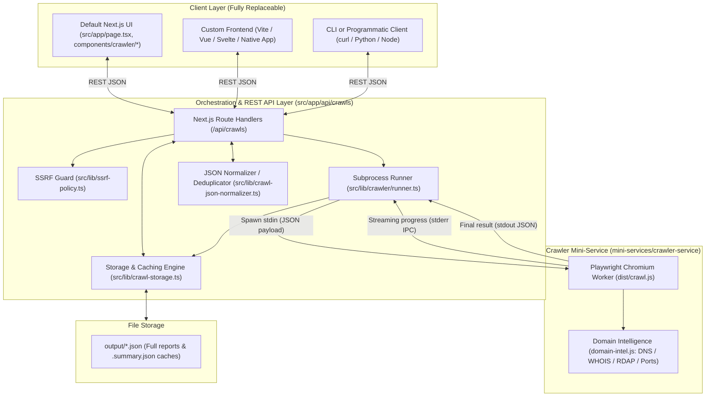

# WebScope — Architecture, Extension & Agents Guide

Welcome to the **WebScope** (`web-crawler-analyzer`) repository. This document serves as the canonical technical guide for software engineers, contributors, and AI coding agents working on or extending this project.

---

## 1. System Overview

**WebScope** is a high-performance, modular web crawler, SEO metadata analyzer, and technology profiler. It extracts structured data (JSON-LD), headings, links, network activity, performance metrics, and network intelligence (DNS, WHOIS, RDAP, open ports) while enforcing strict Server-Side Request Forgery (SSRF) security.

### Core Design Principles
- **Decoupled 3-Tier Architecture:** The Playwright crawler engine, REST API orchestration layer, and presentation UI are completely separated.
- **Pluggable / Fork-Friendly Frontend:** Anyone can fork this repository to build their own custom UI (React, Vite, Vue, Svelte, Mobile App, CLI, or Python client) by consuming the clean JSON REST API.
- **Zero Database Requirement:** Results and summary caches are stored as deterministic JSON files in the `output/` directory with automatic deduplication.
- **Unified SSRF Protection:** Automated blocking of private IP ranges and localhost targets to ensure safe execution in shared and production environments.

---

## 2. Architecture & Component Boundaries



---

## 3. Directory Layout

```
web-crawler-analyzer/
├── .github/workflows/       # GitHub Actions CI/CD pipeline
├── mini-services/
│   └── crawler-service/     # Standalone crawler mini-service
│       ├── __tests__/       # Crawler unit and helper tests
│       ├── crawl.ts         # Playwright scraping & orchestrator worker
│       ├── domain-intel.ts  # DNS, WHOIS, RDAP, Traceroute, Port scanner
│       ├── dist/            # Compiled JavaScript crawler artifacts
│       ├── tsconfig.json    # Crawler TypeScript configuration
│       └── package.json     # Crawler-specific dependencies
├── src/
│   ├── app/                 # Next.js App Router
│   │   ├── api/crawls/      # REST API endpoints
│   │   │   ├── route.ts     # GET (list) & POST (create) crawls
│   │   │   ├── types.ts     # Core shared data contracts & interfaces
│   │   │   └── [id]/        # Individual crawl routes (GET, DELETE, progress, export)
│   │   ├── layout.tsx       # Root HTML layout and fonts
│   │   ├── page.tsx         # Main entry point & view dispatcher
│   │   └── globals.css      # Tailwind CSS styling and theme tokens
│   ├── components/
│   │   ├── crawler/         # Feature UI views (Dashboard, NewCrawl, CrawlDetail, PageDetail)
│   │   └── ui/              # Reusable UI primitives (Radix / shadcn)
│   └── lib/                 # Core utilities and business logic
│       ├── crawler/         # Subprocess runner and execution helpers
│       ├── crawl-storage.ts # JSON filesystem storage & indexing
│       ├── crawl-json-normalizer.ts # Entity deduplication & hash compression
│       ├── ssrf-policy.ts   # Centralized SSRF validation rules
│       ├── domain-utils.ts  # TLD and registrable domain parsing
│       ├── crawler-api.ts   # Client-side API fetch wrapper
│       └── crawler-store.ts # Zustand client UI state store
├── output/                  # Stored crawl results (*.json, *.summary.json)
├── public/                  # Static assets (logo.svg, robots.txt)
├── package.json             # Root dependencies and project scripts
├── tsconfig.json            # Root TypeScript configuration
├── vitest.config.ts         # Vitest test runner configuration
└── AGENTS.md                # This architecture and guide document
```

---

## 4. REST API Specification

All endpoints communicate using standard JSON over HTTP.

### 4.1 List Crawls
- **Endpoint:** `GET /api/crawls`
- **Description:** Returns an array of crawl summaries sorted chronologically (newest first).
- **Response `200 OK`:**
  ```json
  [
    {
      "id": "71eb4227-316b-4734-b02f-9e5fb9b66ebb",
      "name": "example.com 2026-08-31 12:00:00",
      "status": "completed",
      "seedCount": 2,
      "pageCount": 2,
      "errorCount": 0,
      "startedAt": "2026-08-31T15:00:00.000Z",
      "completedAt": "2026-08-31T15:00:12.000Z",
      "avgLoadTimeMs": 145,
      "minLoadTimeMs": 120,
      "maxLoadTimeMs": 170,
      "p95LoadTimeMs": 170
    }
  ]
  ```

### 4.2 Create Crawl
- **Endpoint:** `POST /api/crawls`
- **Description:** Validates URLs against SSRF policy and initiates a background crawl subprocess.
- **Request Body:**
  ```json
  {
    "urls": [
      "https://example.com",
      "https://example.com/about"
    ],
    "name": "My SEO Audit",
    "config": {
      "timeout": 30000,
      "maxPages": 50,
      "concurrency": 2,
      "headless": true,
      "waitForNetwork": 2000,
      "userAgent": "WebScope/1.0"
    }
  }
  ```
- **Response `200 OK`:**
  ```json
  {
    "id": "71eb4227-316b-4734-b02f-9e5fb9b66ebb",
    "name": "My SEO Audit",
    "status": "running",
    "seedCount": 2,
    "pageCount": 0,
    "errorCount": 0,
    "startedAt": "2026-08-31T15:00:00.000Z",
    "completedAt": null
  }
  ```

### 4.3 Get Crawl Detail
- **Endpoint:** `GET /api/crawls/:id`
- **Response `200 OK`:** Returns full `CrawlRecord` including complete `pages` array and `domainIntel`.
- **Response `404 Not Found`:** `{ "error": "Crawl not found" }`

### 4.4 Real-time Progress Polling
- **Endpoint:** `GET /api/crawls/:id/progress`
- **Response `200 OK`:**
  ```json
  {
    "crawlId": "71eb4227-316b-4734-b02f-9e5fb9b66ebb",
    "url": "https://example.com/about",
    "title": "About Us",
    "pageCount": 1,
    "errorCount": 0,
    "status": "running",
    "updatedAt": "2026-08-31T15:00:05.000Z"
  }
  ```

### 4.5 Export Crawl JSON
- **Endpoint:** `GET /api/crawls/:id/export?format=v2`
- **Parameters:**
  - `format=v2` (default): Returns deduplicated, optimized JSON format (`crawl-:id-v2.json`).
  - `format=legacy`: Returns raw, uncompressed crawl record (`crawl-:id.json`).

### 4.6 Delete Crawl
- **Endpoint:** `DELETE /api/crawls/:id`
- **Response `200 OK`:** `{ "success": true }`

---

## 5. Data Model Reference

Core interfaces are defined in [`src/app/api/crawls/types.ts`](file:///E:/Dev/urgorri/web-crawler-analyzer/src/app/api/crawls/types.ts):

### `PageData`
Extracted attributes per individual URL:
- `url`, `finalUrl`, `statusCode`
- `title`, `metaDescription`, `canonical`, `robotsMeta`, `metaGenerator`
- `lang`, `dir`, `charset`, `visibleText`, `wordCount`, `charCount`
- `headings`: `{ h1: string[], h2: string[], h3: string[] }`
- `buttons`: `Array<{ text, type, aria_label, href }>`
- `links`: `{ internal: Array<{ text, href, rel }>, external: Array<{ text, href, rel }> }`
- `forms`: `Array<{ action, method, fields: Array<{ name, type, label }> }>`
- `images`: `Array<{ src, alt, width, height }>`
- `scripts`, `stylesheets`, `resources`, `network`
- `structuredData`: JSON-LD extracted objects
- `bodyClasses`, `htmlClasses`, `techEvidence`
- `loadTimeMs`, `domContentLoadedMs`, `fullContentReadyMs`

### `DomainIntel`
Network intelligence gathered per crawl:
- `seedDomain`, `observedDomain`, `seedUrl`, `resolvedIps`
- `dns`: `a`, `aaaa`, `ns`, `mx`, `cname`, `txt` records
- `whoisDomain`, `whoisIp`, `rdapIp`
- `traceroute`: hop latency and route hops
- `ports`: open/closed status for common web services (HTTP, HTTPS, SSH, SMTP, DBs)

---

## 6. How to Build a Custom Frontend / Headless Client

Because the REST API is 100% decoupled from the UI, you can connect any frontend:

### Option 1: Replace UI within the Next.js App
Modify `src/app/page.tsx` or swap components inside `src/components/crawler/`. The frontend uses typed helpers from `src/lib/crawler-api.ts`:
```typescript
import { getCrawls, createCrawl, getCrawl, getCrawlProgress, deleteCrawl } from '@/lib/crawler-api';

// Example: Start crawl
const crawl = await createCrawl(['https://example.com'], { timeout: 20000 });
```

### Option 2: Build a Standalone Frontend (Vite / Vue / Svelte / Mobile)
Run the Next.js backend on `http://localhost:3000` and send standard HTTP requests to `/api/crawls`.

### Option 3: Use the Crawler Directly via CLI
The standalone crawler can be executed from terminal via stdin/stdout:
```bash
echo '{"urls":["https://example.com"],"config":{"headless":true}}' | node mini-services/crawler-service/dist/crawl.js
```

---

## 7. Subprocess IPC & Streaming Protocol

When Next.js initiates a crawl:
1. `src/lib/crawler/runner.ts` spawns `mini-services/crawler-service/dist/crawl.js`.
2. Input payload is written as JSON into `child.stdin`.
3. As each page is crawled, the worker emits single-line progress updates to `stderr`:
   ```
   PROGRESS_UPDATE:{"crawlId":"...","url":"https://...","title":"...","pageCount":1,"errorCount":0,"status":"running"}
   ```
4. The runner parses these lines and persists real-time progress to `output/:id.progress.json`.
5. Upon completion, the worker writes the full result JSON payload exclusively to `stdout`.

---

## 8. Security & SSRF Policy

- **Default Behavior:** Requests targeting private network ranges (`10.0.0.0/8`, `172.16.0.0/12`, `192.168.0.0/16`, `127.0.0.0/8`, `169.254.0.0/16`) or localhost aliases are rejected with `PRIVATE_NETWORK_BLOCKED`.
- **Development Override:** To allow crawling local services during development, launch with:
  ```bash
  ALLOW_PRIVATE_TARGETS=true npm run dev
  ```
- **Scope Restriction:** A single crawl job only accepts URLs sharing the same registrable domain as the first seed URL.

---

## 9. Development, Testing & Verification Commands

| Command | Description |
|---|---|
| `npm run dev` | Starts Next.js development server on port 3000 |
| `npm run prebuild` | Builds the crawler mini-service TypeScript to `dist/` |
| `npm run build` | Compiles both crawler service and Next.js standalone application |
| `npm start` | Starts Next.js production standalone server |
| `npm run lint` | Runs ESLint across all source and test files |
| `npm run typecheck` | Validates TypeScript types across the entire project (`tsc --noEmit`) |
| `npm test` | Executes all 15 Vitest test suites (134+ unit and integration tests) |
| `npm run test:watch` | Runs Vitest in interactive watch mode |
| `npx playwright install chromium` | Installs Playwright Chromium browser binaries |
