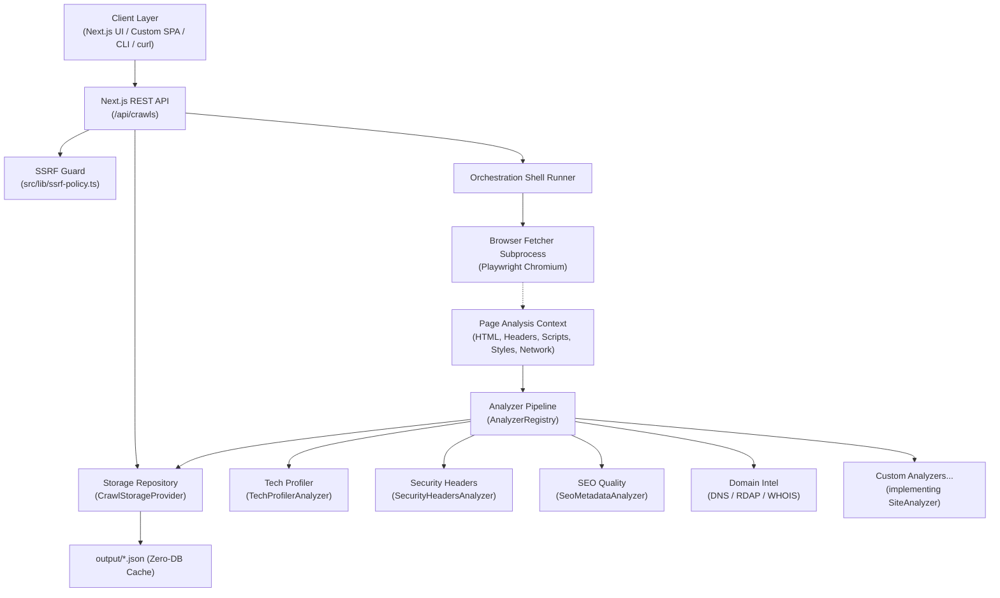

# WebScope — Web Analysis Orchestration Shell & Boilerplate

[](https://github.com/urgorri/web-crawler-analyzer/actions/workflows/ci.yml)
[](LICENSE)
[](package.json)
[](tsconfig.json)

**WebScope** is a modern, modular web crawler, SEO metadata analyzer, and web intelligence orchestration shell built with Next.js, Playwright, and Tailwind CSS.

It is designed to serve as both an **out-of-the-box analysis tool** and an **open-source boilerplate & shell**: fetching site content with headless browsers and orchestrating specialized, pluggable analysis modules (Security, Technology Profiling, SEO, Domain Intelligence) through clean contracts.

---

## Key Highlights

- **Orchestration Shell Pattern**: Decouples content fetching (Playwright browser worker) from modular analysis passes (`SiteAnalyzer` plugin pipeline).
- **Pluggable Analyzers**: Enable, disable, or add custom analyzers (Tech Profiling, Security Headers, SEO, Lighthouse) in minutes.
- **Pluggable Persistence (`CrawlStorageProvider`)**: Ships with zero-database flat-file JSON caching by default; easily swapped for SQLite, PostgreSQL, or S3 via repository interface.
- **Purpose-Built Delegated Tools**:
  - **Technology Profiling**: Identifies frameworks, CMSs, CSS toolkits, analytics, and CDNs from script signatures, HTML markers, and response headers.
  - **HTTP Security Headers**: Audits CSP, HSTS, X-Frame-Options, X-Content-Type-Options, Referrer-Policy, and Permissions-Policy with automated scoring.
  - **SEO & Metadata Quality**: Evaluates title length, meta description, heading structure, canonical link, OpenGraph tags, and image alt text.
  - **Network & Domain Intel**: Gathers DNS (A, AAAA, MX, NS, TXT), WHOIS, RDAP, and network hops with strict timeout isolation.
- **SSRF Hardening**: Automated blocking of private IP ranges (`10.0.0.0/8`, `192.168.0.0/16`, `127.0.0.0/8`) and localhost aliases.
- **Clean Monorepo & Cross-Platform**: npm workspaces, typed REST API, and native compatibility across Windows, macOS, and Linux.

---

## Architecture Overview



---

## Prerequisites

- **Node.js**: `20.x` or higher.
- **npm**: `10.x` or higher.

---

## Quickstart

### 1. Clone & Install
```bash
git clone https://github.com/urgorri/web-crawler-analyzer.git
cd web-crawler-analyzer
npm install
```

### 2. Install Playwright Chromium
```bash
npx playwright install chromium
```

### 3. Build Crawler Mini-Service
```bash
npm run prebuild
```

### 4. Run Development Server
```bash
npm run dev
```

Open [http://localhost:3000](http://localhost:3000) in your browser.

> [!NOTE]
> To crawl localhost or local development services during testing, set `ALLOW_PRIVATE_TARGETS=true npm run dev` (or copy `.env.example` to `.env.local`).

---

## How to Add a Custom Analyzer in 5 Minutes

WebScope's plugin architecture makes extending analysis trivial:

1. Create a class implementing `SiteAnalyzer` in `src/lib/analyzers/`:

```typescript
// src/lib/analyzers/my-custom-analyzer.ts
import type { AnalysisContext, SiteAnalyzer } from './types';

export class MyCustomAnalyzer implements SiteAnalyzer<{ wordCount: number }> {
  public readonly id = 'word-counter';
  public readonly name = 'Word Counter';
  public readonly category = 'seo' as const;
  public readonly description = 'Calculates visible words and density';

  public async isAvailable(): Promise<boolean> {
    return true; // Return false if external dependencies or CLI tools are missing
  }

  public async run(context: AnalysisContext) {
    const text = context.html || '';
    const wordCount = text.split(/\s+/).filter(Boolean).length;
    return { wordCount };
  }
}
```

2. Register your analyzer in `src/lib/analyzers/index.ts`:

```typescript
import { defaultAnalyzerRegistry } from './registry';
import { MyCustomAnalyzer } from './my-custom-analyzer';

defaultAnalyzerRegistry.register(new MyCustomAnalyzer());
```

Your analyzer is now automatically executed as part of the crawl pipeline, with results persisted and accessible in the API response and UI.

---

## Environment Variables

Copy `.env.example` to `.env.local` to customize runtime options:

| Variable | Default | Description |
|---|---|---|
| `ALLOW_PRIVATE_TARGETS` | `false` | When `true`, permits crawling `localhost` and private IP ranges for local testing. |
| `ALLOW_TS_CRAWLER_FALLBACK` | `false` | When `true`, executes the crawler via `tsx` if compiled artifacts are missing. |
| `PORT` | `3000` | HTTP port for the Next.js server. |
| `PLAYWRIGHT_BROWSERS_PATH` | System default | Path to cached Playwright browser binaries. |
| `DISABLE_TRACEROUTE` | `false` | Skip ICMP/traceroute network probes in restricted environments. |
| `DISABLE_PORT_SCAN` | `false` | Skip TCP port scanning in restricted network environments. |

---

## Available Scripts

| Command | Description |
|---|---|
| `npm run dev` | Starts Next.js development server on port 3000 |
| `npm run prebuild` | Compiles the crawler mini-service TypeScript to `dist/` |
| `npm run build` | Compiles crawler service and generates standalone Next.js distribution |
| `npm start` | Launches production server from `.next/standalone/server.js` |
| `npm run lint` | Runs ESLint across all TypeScript and React code |
| `npm run typecheck` | Validates TypeScript types across the entire project (`tsc --noEmit`) |
| `npm test` | Runs the Vitest test suite |
| `npm run test:watch` | Runs Vitest in interactive watch mode |

---

## Documentation

- [Architecture & Agents Guide](AGENTS.md)
- [Contributing Guidelines](CONTRIBUTING.md)
- [Code of Conduct](CODE_OF_CONDUCT.md)
- [Security Policy](SECURITY.md)
- [Disclaimer](DISCLAIMER.md)

---

## Credits

Built by [Gastón Urgorri](https://github.com/urgorri).

## License

This project is open-source under the [MIT License](LICENSE).
